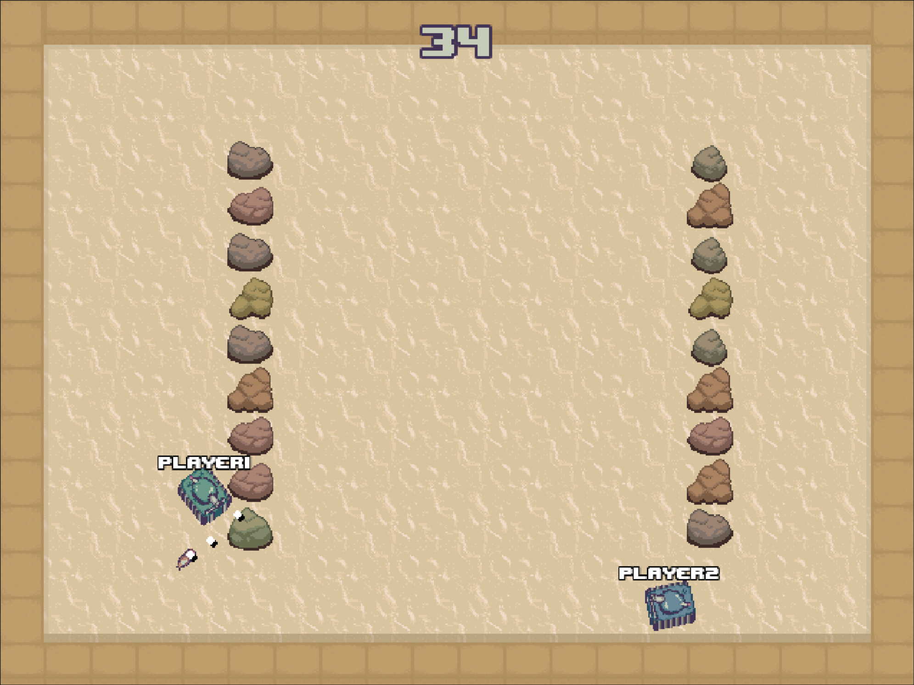
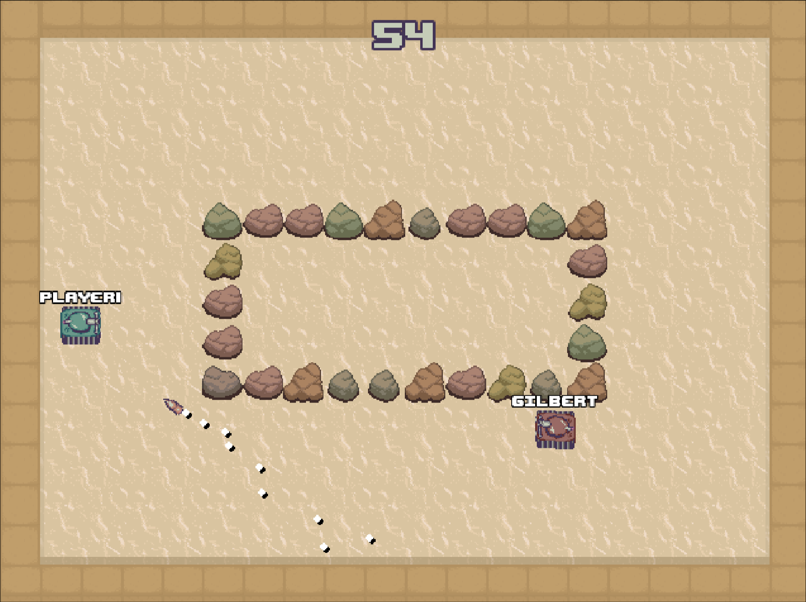

# TAGD Tanks

<p align="center">
  
</p>


TAGD Tanks is a toy game for developing AI enemies and player sprites. Players code their own tank AI and have them face off in a 1v1 duel. 

<p align="center">
  
  
</p>


# Usage 
## Prerequisites
- Python >= 3.9
- Git
- An IDE (VSCode)

## Set Up

First, in your working directory, clone the git repo:

```bash
git clone https://github.com/JonahCoffelt/TAGDTanks.git . 
```
If you do not have git, you can also download the zip from the github page

In your working directory, create a python virtual enviornment and enter and initialize it:

```bash
python -m venv .venv
source .venv\\bin\\activate   # or source .venv/bin/activate for linux/mac
pip install -e .
```

## Running the Game
Run from `main.py`:

```bash
python main.py
```


# Developing a Bot
## Bot AI
Bots are stored in the `.\bots\` folder. You should develop in `.\bots\MyBot\controller.py`. To program your bot's behavior, edit the `update()` method in the `Controller` class. The update method is called every frame to get the current actions of your bot. 

When developing your bot, you can use the following actions:

    - self.turn_body_clockwise()
    - self.turn_body_counter_clockwise()
    - self.turn_gun_clockwise()
    - self.turn_gun_counter_clockwise()
    - self.move_forward()
    - self.move_backward()
    - self.shoot()

And you can access the following member variables:

    - self.x: the x position of the tank (in grid units)
    - self.y: the y position of the tank (in grid units)
    - self.enemy_x: the x position of the enemy tank (in grid units)
    - self.enemy_y: the y position of the enemy tank (in grid units)
    - self.body_direction: the current direction of the body (in degrees)
    - self.gun_direction: the current direction of the gun (in degrees)
    - self.gun_ready: whether the gun is ready to shoot (True or False)
    - self.enemy_bullets: a list of enemy bullets (see EnemyBullet class for more information)
    - self.map: the current map (a 20x15 numpy array, where map[x][y] == True if there is a wall, False otherwise)
    - self.dt: the time since the last frame (in seconds)

If your bot's cod

## Bot Sprites
You can replace the sprites in your bot's folder and they will change in game. All sprites should be `32x32` pixels. The bot needs:

- 1 Idle body frame
- 3 Body move frames
- 1 Idle gun frame
- 3 Gun shoot frames
- 1 Bullet sprite

If you really want to change the pixel size, you can, but it needs to be a sqaure image and all images need the same dimensions. 